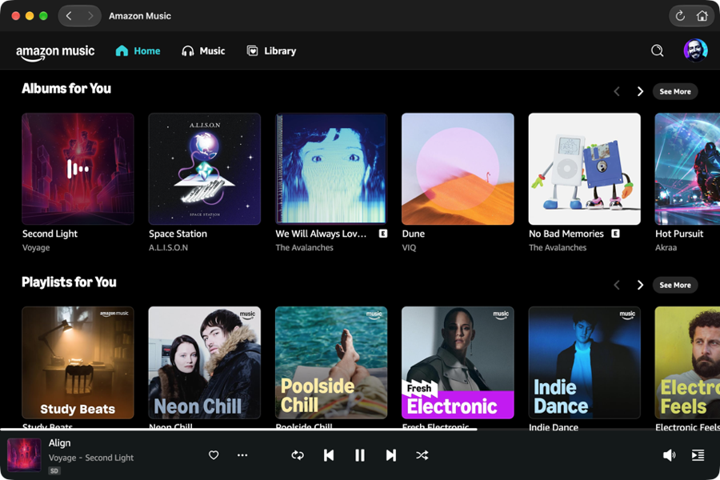
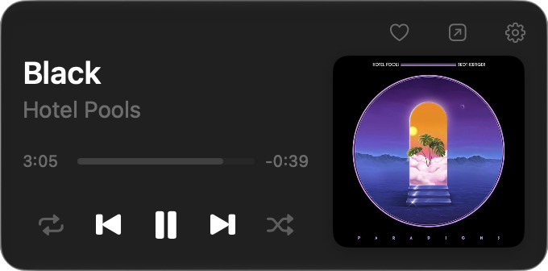
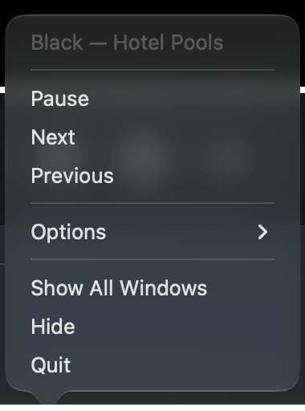
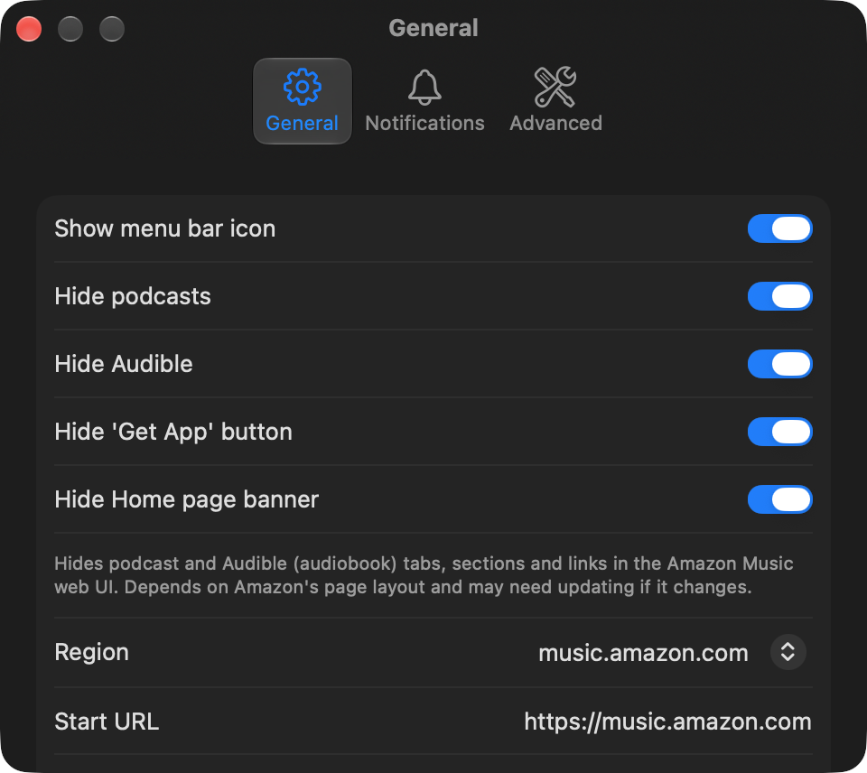
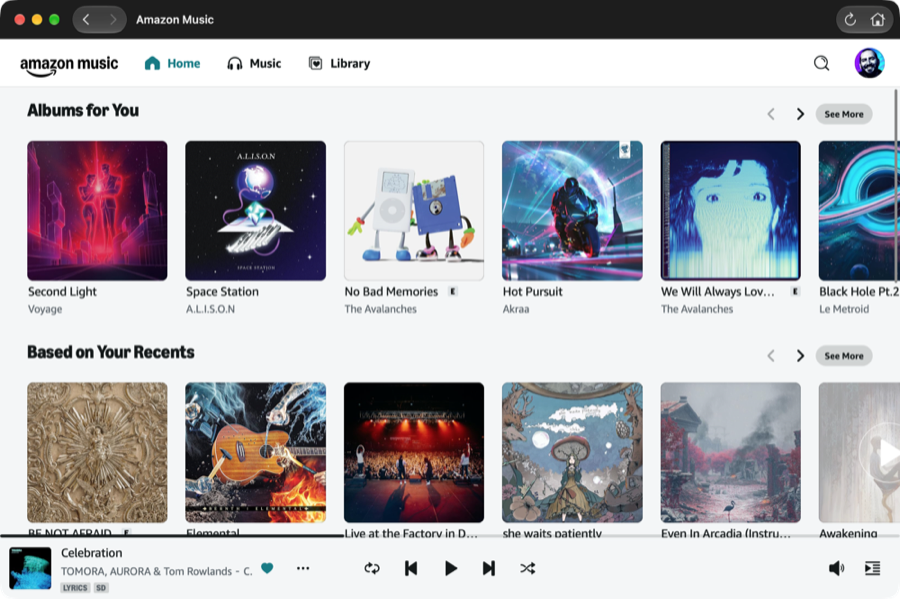
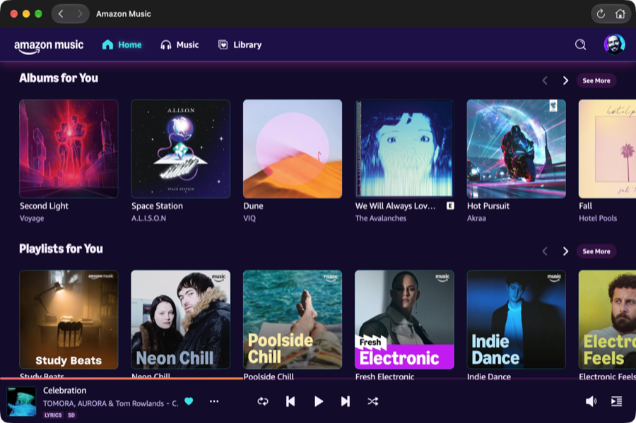
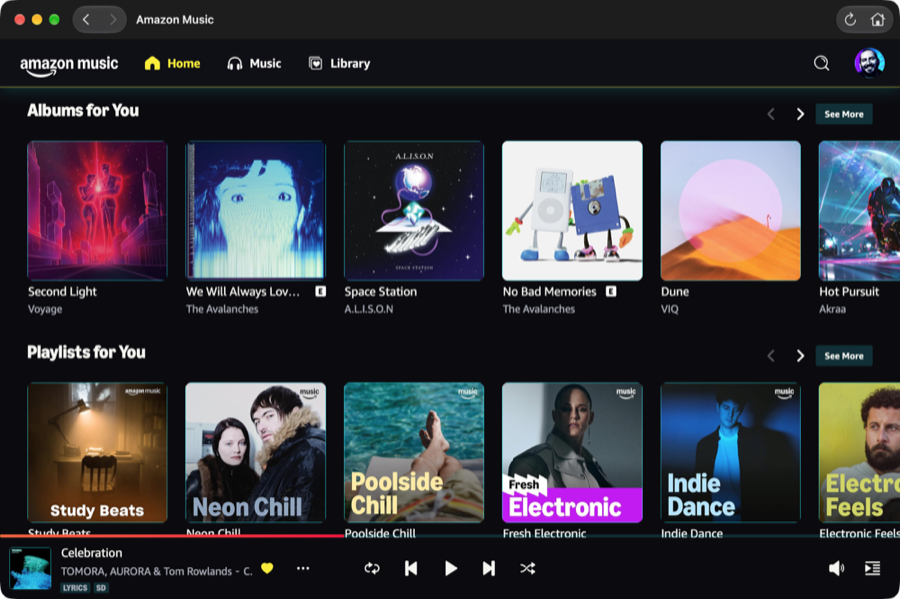
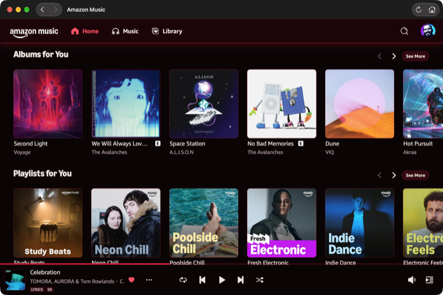

# Amazon Music for Mac


An unofficial, native Apple silicon macOS app for Amazon Music.

## Why

Amazon's official desktop app is going away, and the web player lacks macOS integration (media keys, Control Center, menu bar). This app wraps the web player in a native shell and adds that integration.

## Features

- Native Apple silicon (arm64) app, macOS 26+
- Hosts music.amazon.com in a `WKWebView`; playback uses WebKit's FairPlay, so audio is delivered by Amazon's own player
- Media keys, Control Center and AirPods controls via Now Playing
- Menu bar mini player: cover, title, progress, controls, shuffle, repeat, like, Play Similar Music
- Up Next queue in the mini player: collapsed shows the next song, expanded lists up to 10; click a song in the list to jump to it
- Dock menu, and a right-click menu on the menu bar item
- Track-change notifications
- Keeps playing when the window is closed
- Controls and Navigation menus with [keyboard shortcuts](#keyboard-shortcuts)
- [Web themes](#themes): Default, Light, Synthwave, Cyberpunk, Vampire
- `amazonmusic://` [URL scheme](#url-scheme) for media controls and opening pages
- [Shortcuts and Siri actions](#shortcuts-and-siri) (App Intents)
- Open at login (Settings → General)
- [`amazonmusic` command line and MCP server](#command-line-and-mcp) for scripts and AI agents
- Settings: hide podcasts, hide Audible, hide the "Get App" button, hide the Home banner, region/start URL, user-agent override, reset website data. The top bar spacing stays even when sections are hidden.

## Screenshots



| Menu bar mini player | Dock menu |
| --- | --- |
|  |  |



## Keyboard shortcuts

From `App/PlayerCommands.swift`. Controls items are disabled until a track is playing.

| Action | Menu | Shortcut |
| --- | --- | --- |
| Play / Pause | Controls | ⌘P |
| Next | Controls | ⌘→ |
| Previous | Controls | ⌘← |
| Like / Unlike | Controls | ⌘L |
| Shuffle | Controls | ⌥⌘S |
| Repeat (cycles off, all, one) | Controls | ⌥⌘R |
| Play Similar | Controls | ⇧⌘S |
| Back | View | ⌘[ |
| Forward | View | ⌘] |
| Reload | View | ⌘R |
| Home | View | ⇧⌘H |

Space is not bound, so typing in search still works and Amazon's page handles Space itself. Print is removed to free ⌘P.

## Themes

Pick one in **Settings → General → Theme**. Themes are CSS injected into the page; they re-map Amazon's inline palette, so they may need updating when the site changes (see [Known limitations](#known-limitations-and-risks)). To add one, see [docs/THEMES.md](docs/THEMES.md).

| Default | Light |
| --- | --- |
|  |  |
| **Synthwave** | **Cyberpunk** |
|  |  |
| **Vampire** | |
|  | |

## URL scheme

```sh
open 'amazonmusic://toggle'
open 'amazonmusic://next'
open 'amazonmusic://open?path=/search/jazz'
```

Hosts: `play`, `pause`, `toggle`, `next`, `previous`, `like`, `shuffle`, `repeat`, `similar`, and `open?path=<path>`. Links are validated strictly in `Integrations/URLRouter.swift`: the path must start with `/`, is at most 512 characters, uses only URL characters, and can't contain `..`, `//`, `\`, control characters, or a scheme. Only music.amazon.com is ever loaded. There is no seek or queue control over URLs. Rejected links are ignored and logged by reason code only.

## Shortcuts and Siri

App Intents appear in the Shortcuts app and work with Siri:

- Play/Pause
- Next
- Previous
- Like
- Play Similar
- Now Playing (returns the current track)

## Command line and MCP

The app binary doubles as a CLI, `amazonmusic`. It talks to the running app over a Unix socket. Every command takes `--json`.

| Command | Type | What it does |
| --- | --- | --- |
| `status` | read | App running, bridge healthy, signed in, open page path |
| `track show` | read | Title, artist, album, position, duration, play, like, shuffle, repeat |
| `queue list [--limit N --offset N]` | read | Up Next queue; ids work with `queue play` |
| `player play` / `pause` / `toggle` | write | Start, pause, toggle |
| `player next` / `previous` | write | Skip |
| `player shuffle` | write | Toggle shuffle |
| `player repeat` | write | Cycle repeat: off, all, one |
| `player seek --seconds N` | write | Jump to a position |
| `track like` | write | Like the current track (`changed: false` if already liked) |
| `track similar` | write | Start a station of similar music |
| `queue play --id ID` | write | Jump to an Up Next entry |
| `open --path /search?q=jazz` | write | Show a music.amazon.com page (same validation as the URL scheme) |

More: `amazonmusic help`, `amazonmusic help <command>`, `amazonmusic help --json`. Exit codes: 0 ok, 1 error, 2 usage, 3 not found, 4 app not running. There are no destructive commands.

**Install.** `scripts/build.sh --open` links `~/.local/bin/amazonmusic` to the installed app. For a release install:

```sh
mkdir -p ~/.local/bin
ln -sf /Applications/AmazonMusic.app/Contents/MacOS/AmazonMusic ~/.local/bin/amazonmusic
```

**MCP.** `amazonmusic mcp` serves the same commands as MCP tools over stdio; read-only ones carry `readOnlyHint`. For Claude Code:

```sh
claude mcp add amazonmusic -- amazonmusic mcp
```

**Security.** The socket is `~/Library/Application Support/AmazonMusic/agent.sock` (directory 0700, socket 0600). The server checks that the peer is the same user, caps requests at 64 KB per line and allows at most 8 concurrent connections. It only runs in normal mode, never with `--snapshot` or `--selftest`. `APP_AGENT_SOCKET=<path>` moves it.

A Claude Code skill for these commands is in [`.claude/skills/amazonmusic/`](.claude/skills/amazonmusic/SKILL.md).

## Requirements

- macOS 26
- Xcode 27+
- [XcodeGen](https://github.com/yonaskolb/XcodeGen): `brew install xcodegen`

## Installing a release

Prebuilt builds for Apple silicon are on the [Releases](https://github.com/khalidabuhakmeh/amazon-music-mac/releases) page. Requires macOS 26.

1. Download `AmazonMusic-<version>.dmg`, open it and drag **Amazon Music** to **Applications**. Or download the `.zip`, unzip it and move the app to Applications.
2. Open the app. macOS shows *"Apple could not verify 'Amazon Music' is free of malware…"*. Click **Done**, not Move to Trash.
3. Open **System Settings → Privacy & Security**, scroll to **Security**, and click **Open Anyway** next to the message about the app. Confirm with your password or Touch ID, then click **Open Anyway** again.

The app appears as **Amazon Music** in Finder, the Dock, the menu bar and Spotlight. On disk it is `AmazonMusic.app`, so use that name in Terminal commands.

You only need to do this once per downloaded version. Right-click → Open no longer bypasses this check on current macOS versions.

Why the warning appears: the releases are ad-hoc signed and not notarized by Apple, because the project has no paid Apple Developer ID. Gatekeeper blocks any downloaded app that isn't notarized. The app is built from this repository by the [Release workflow](.github/workflows/release.yml), and `SHA256SUMS.txt` on each release lets you check the download.

If macOS instead says the app *"is damaged and can't be opened"*, or Open Anyway doesn't appear, remove the quarantine flag in Terminal and open it again:

```sh
xattr -dr com.apple.quarantine /Applications/AmazonMusic.app
```

## Build and install from source

```sh
./scripts/build.sh                    # Debug
CONFIG=Release ./scripts/build.sh     # Release
cp -R build/Build/Products/Release/AmazonMusic.app /Applications/
```

`scripts/build.sh --open` also installs to `~/Applications`, links the CLI and relaunches the app. `--selftest` builds, then runs the binary's `--selftest`.

`build.sh` marks `build/` so Spotlight doesn't index it; otherwise every Debug and Release build shows up as another app in Spotlight. Builds made from Xcode go to DerivedData and are still indexed.

The app is ad-hoc signed and runs locally. A copy built on your own Mac isn't quarantined, so Gatekeeper doesn't block it. Developer ID signing and notarization are not set up.

## Publishing a release

Push a version tag and the [Release workflow](.github/workflows/release.yml) builds the app on GitHub's Xcode 27 runner, then creates a GitHub Release with a `.dmg`, a `.zip` and checksums:

```sh
git tag v1.0.0
git push origin v1.0.0
```

Running the workflow manually from the Actions tab builds the same files as a downloadable workflow artifact without creating a release.

## First run

Launch the app and sign in to Amazon once. The session persists across launches.

## How it works

- A `WKWebView` shell loads the Amazon Music web player.
- `bridge.js` is injected into the page. It reads `navigator.mediaSession` and the media element, reports state, and sends commands (play, pause, next, previous, seek, shuffle, repeat, like).
- Messages are decoded into `PlayerState`, which feeds the integrations: Now Playing, menu bar mini player, Dock menu, notifications.
- `hideSections.js` hides page sections according to settings.
- The visible name comes from `Resources/en.lproj/InfoPlist.strings`. `PRODUCT_NAME` and the non-localized `CFBundleDisplayName` stay `AmazonMusic`, matching the bundle file name. Finder only uses the localized name when that matches, and space-free paths keep the scripts simple.
- All DOM selectors live in `bridge.js` and `hideSections.js` and are versioned, so page changes are fixed in one place.

## Project layout

```
Sources/AmazonMusic/
  Agent/          CLI commands, socket, MCP server (`amazonmusic`)
  App/            app entry, delegate, window coordinator, Controls/Navigation menus, snapshot and self-test runners
  Bridge/         message decoding, commands, WKScriptMessage handler
  Integrations/   Now Playing, Dock menu, status item, notifications, artwork cache, URL router, login item
  Intents/        App Intents for Shortcuts and Siri
  Model/          PlayerState, TrackInfo
  Resources/      bridge.js, hideSections.js, themeHelper.js, themes/*.css, assets, entitlements, en.lproj (display name)
  Settings/       AppSettings
  UI/             main window, settings view, design tokens, MiniPlayer/ parts
  Web/            web view, popups, navigation policy, theme
Tests/            Swift Testing unit tests
tools/            JS tests (bridge, hideSections), icon generator, grid-lint.sh
scripts/          build.sh, snapshot.sh
design/           DESIGN-SYSTEM.md
docs/             notes, QA checklist, STORIES.md, THEMES.md, screenshots
.claude/skills/   Claude Code skill for the CLI
project.yml       XcodeGen project definition
```

## Build and verify

```sh
scripts/build.sh [--open|--selftest]   # build; install and relaunch; or run the self-test
scripts/snapshot.sh --baseline         # save light and dark window snapshots of every page
scripts/snapshot.sh --diff             # compare against the baseline (needs ImageMagick)
tools/grid-lint.sh                     # flags off-grid spacing numbers in UI/
```

`--snapshot <dir>` and `--selftest` are app launch modes. They use fixtures and don't touch the network. Design rules and tokens: [design/DESIGN-SYSTEM.md](design/DESIGN-SYSTEM.md).

## Testing

The Swift tests use Swift Testing (100+ tests).

```sh
xcodebuild test -scheme AmazonMusic -destination 'platform=macOS,arch=arm64' -derivedDataPath build
node tools/bridge-test/bridge.test.mjs
node tools/hidesections-test/hidesections.test.mjs
```

Manual checklist: [docs/QA.md](docs/QA.md).

Further notes: [media controls](docs/MEDIA_CONTROLS.md), [shuffle/repeat](docs/CONTROLS.md), [like](docs/LIKE.md), [podcasts/Audible](docs/PODCASTS.md), [Up Next queue](docs/QUEUE.md), [initial spike](docs/SPIKE.md), [user stories](docs/STORIES.md), [themes](docs/THEMES.md), [design system](design/DESIGN-SYSTEM.md).

## Known limitations and risks

- It depends on Amazon's page structure and may break when the site changes.
- Themes depend on Amazon's inline palette and may need updating when the site changes.
- The title bar follows the system appearance, not the theme.
- Any app or web page can trigger `amazonmusic://` links. They only control media and open music.amazon.com pages.
- The app is ad-hoc signed, so registering the Login Item may need approval in System Settings → General → Login Items.
- Use it for personal use in line with Amazon's Terms of Service. This project is not affiliated with or endorsed by Amazon.
- It does not circumvent DRM; playback goes through WebKit's own FairPlay support.
- WebKit may publish its own Now Playing entry alongside the app's. See [docs/MEDIA_CONTROLS.md](docs/MEDIA_CONTROLS.md).

## Disclaimer

Unofficial project. "Amazon Music" is a trademark of Amazon.com, Inc. or its affiliates.

## License

[MIT](LICENSE), copyright 2026 Khalid Abuhakmeh.
