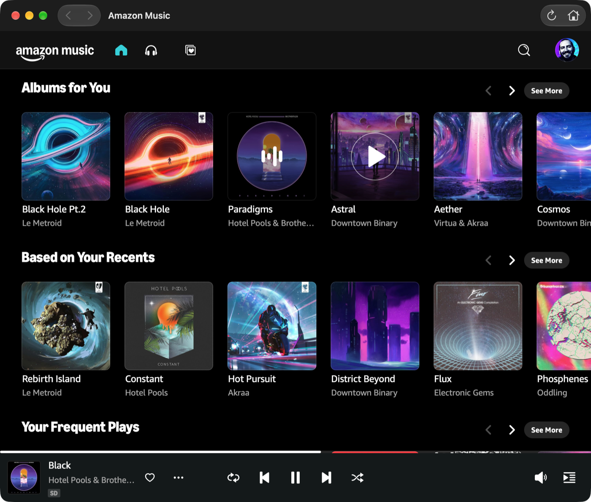
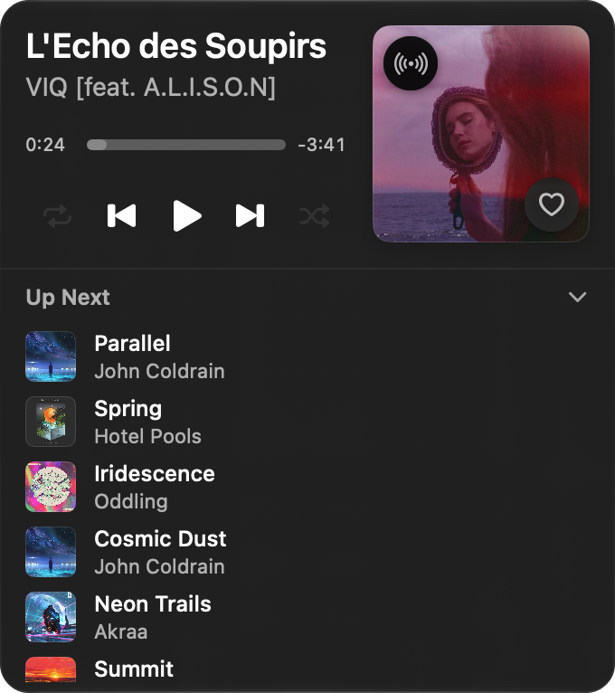
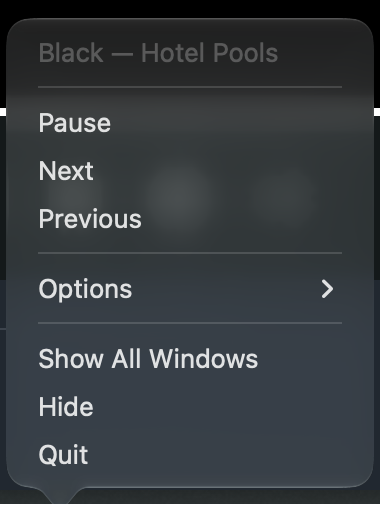
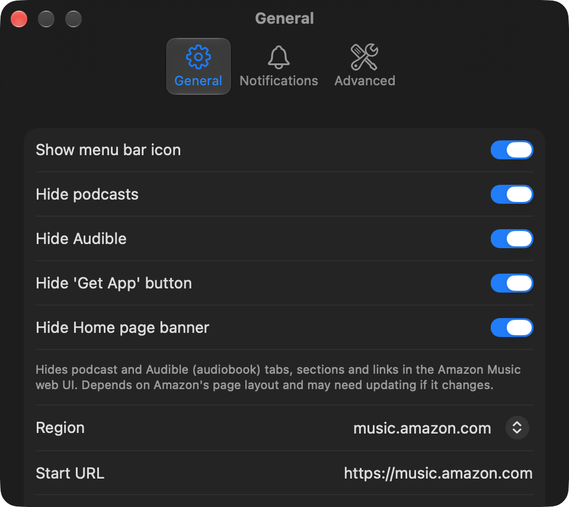

# Amazon Music for Mac


An unofficial, native Apple silicon macOS app for Amazon Music.

## Why

Amazon's official desktop app is going away, and the web player lacks macOS integration (media keys, Control Center, menu bar). This app wraps the web player in a native shell and adds that integration.

## Features

- Native Apple silicon (arm64) app, macOS 26+
- Hosts music.amazon.com in a `WKWebView`; playback uses WebKit's FairPlay, so audio is delivered by Amazon's own player
- Media keys, Control Center and AirPods controls via Now Playing
- Menu bar mini player: cover, title, progress, controls, shuffle, repeat, like, Play Similar Music
- Up Next queue in the mini player: collapsed shows the next song, expanded lists up to 10; click a song to jump to it
- Dock menu, and a right-click menu on the menu bar item
- Track-change notifications
- Keeps playing when the window is closed
- Settings: hide podcasts, hide Audible, hide the "Get App" button, hide the Home banner, region/start URL, user-agent override, reset website data

## Screenshots



| Menu bar mini player | Dock menu |
| --- | --- |
|  |  |



## Requirements

- macOS 26
- Xcode 27+
- [XcodeGen](https://github.com/yonaskolb/XcodeGen): `brew install xcodegen`

## Installing a release

Prebuilt builds for Apple silicon are on the [Releases](https://github.com/khalidabuhakmeh/amazon-music-mac/releases) page. Requires macOS 26.

1. Download `AmazonMusic-<version>.dmg`, open it and drag **AmazonMusic** to **Applications**. Or download the `.zip`, unzip it and move the app to Applications.
2. Open the app. macOS shows *"Apple could not verify 'AmazonMusic' is free of malware…"*. Click **Done**, not Move to Trash.
3. Open **System Settings → Privacy & Security**, scroll to **Security**, and click **Open Anyway** next to the AmazonMusic message. Confirm with your password or Touch ID, then click **Open Anyway** again.

You only need to do this once per downloaded version. Right-click → Open no longer bypasses this check on current macOS versions.

Why the warning appears: the releases are ad-hoc signed and not notarized by Apple, because the project has no paid Apple Developer ID. Gatekeeper blocks any downloaded app that isn't notarized. The app is built from this repository by the [Release workflow](.github/workflows/release.yml), and `SHA256SUMS.txt` on each release lets you check the download.

If macOS instead says the app *"is damaged and can't be opened"*, or Open Anyway doesn't appear, remove the quarantine flag in Terminal and open it again:

```sh
xattr -dr com.apple.quarantine /Applications/AmazonMusic.app
```

## Build and install from source

```sh
./scripts/build.sh                    # Debug
CONFIG=Release ./scripts/build.sh     # Release
cp -R build/Build/Products/Release/AmazonMusic.app /Applications/
```

The app is ad-hoc signed and runs locally. A copy built on your own Mac isn't quarantined, so Gatekeeper doesn't block it. Developer ID signing and notarization are not set up.

## Publishing a release

Push a version tag and the [Release workflow](.github/workflows/release.yml) builds the app on GitHub's Xcode 27 runner, then creates a GitHub Release with a `.dmg`, a `.zip` and checksums:

```sh
git tag v1.0.0
git push origin v1.0.0
```

Running the workflow manually from the Actions tab builds the same files as a downloadable workflow artifact without creating a release.

## First run

Launch the app and sign in to Amazon once. The session persists across launches.

## How it works

- A `WKWebView` shell loads the Amazon Music web player.
- `bridge.js` is injected into the page. It reads `navigator.mediaSession` and the media element, reports state, and sends commands (play, pause, next, previous, seek, shuffle, repeat, like).
- Messages are decoded into `PlayerState`, which feeds the integrations: Now Playing, menu bar mini player, Dock menu, notifications.
- `hideSections.js` hides page sections according to settings.
- All DOM selectors live in `bridge.js` and `hideSections.js` and are versioned, so page changes are fixed in one place.

## Project layout

```
Sources/AmazonMusic/
  App/            app entry, delegate, window coordinator
  Bridge/         message decoding, commands, WKScriptMessage handler
  Integrations/   Now Playing, Dock menu, status item, notifications, artwork cache
  Model/          PlayerState, TrackInfo
  Resources/      bridge.js, hideSections.js, assets, entitlements
  Settings/       AppSettings
  UI/             main window, mini player, settings view
  Web/            web view, popups, navigation policy
Tests/            XCTest unit tests
tools/            JS tests (bridge, hideSections), icon generator
scripts/          build.sh
docs/             investigation notes and QA checklist
project.yml       XcodeGen project definition
```

## Testing

```sh
xcodebuild test -scheme AmazonMusic -destination 'platform=macOS,arch=arm64' -derivedDataPath build
node tools/bridge-test/bridge.test.mjs
node tools/hidesections-test/hidesections.test.mjs
```

Manual checklist: [docs/QA.md](docs/QA.md).

Further notes: [media controls](docs/MEDIA_CONTROLS.md), [shuffle/repeat](docs/CONTROLS.md), [like](docs/LIKE.md), [podcasts/Audible](docs/PODCASTS.md), [Up Next queue](docs/QUEUE.md), [initial spike](docs/SPIKE.md).

## Known limitations and risks

- It depends on Amazon's page structure and may break when the site changes.
- Use it for personal use in line with Amazon's Terms of Service. This project is not affiliated with or endorsed by Amazon.
- It does not circumvent DRM; playback goes through WebKit's own FairPlay support.
- WebKit may publish its own Now Playing entry alongside the app's. See [docs/MEDIA_CONTROLS.md](docs/MEDIA_CONTROLS.md).

## Disclaimer

Unofficial project. "Amazon Music" is a trademark of Amazon.com, Inc. or its affiliates.

## License

[MIT](LICENSE), copyright 2026 Khalid Abuhakmeh.
